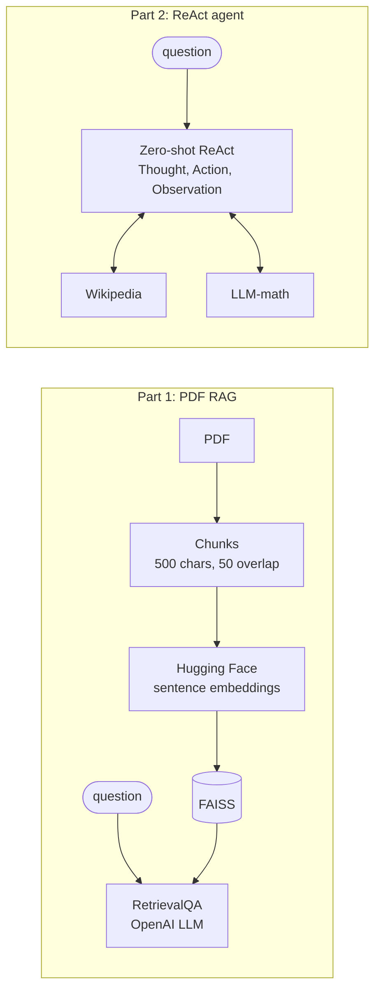

# PDF RAG and a Zero-Shot ReAct Agent (LangChain)

**Two classic LLM patterns side by side: retrieval-augmented QA over a PDF with FAISS, and a ReAct agent that reasons step by step and calls Wikipedia and a calculator. The agent's saved run includes a confident wrong answer, kept here on purpose.**

[](https://colab.research.google.com/github/dojedaro/pdf-rag-react-agent-langchain/blob/main/pdf_rag_and_react_agent.ipynb)
[](https://github.com/dojedaro/pdf-rag-react-agent-langchain/actions/workflows/notebooks.yml)

> Part of a series of RAG projects: [strict PDF QA](https://github.com/dojedaro/strict-pdf-question-answering) ·
> **PDF RAG + ReAct agent** ·
> [policy QA with evaluation](https://github.com/dojedaro/openai-rag-policy-qa-evaluation) ·
> [10-K retrieval evaluation](https://github.com/dojedaro/coca-cola-10k-retrieval-evaluation) ·
> [research-paper RAG](https://github.com/dojedaro/research-paper-rag-qa-system)

## Results from the saved run

| Question | Agent's answer | Verdict |
|---|---|---|
| What is the population of France, and its square root? | 66,352,000; √ ≈ 8,145.67. Then, unasked: Canada 41,500,000, √ ≈ 6,442.05 | Arithmetic right; population taken from an outdated Wikipedia figure; **drifted off scope** |
| What is cos(60°) + ln(10)? | **1.35** | **Wrong.** cos 60° = 0.5, so the answer is **2.80**. The calculator tool got `cos(60)` in radians (−0.952). |

The second row is why I keep this notebook public. The agent's reasoning trace looks careful, ends
with "I should round the answer to two decimal places", and is confidently wrong because a tool
silently assumed radians. Tool-using agents need checks on tool inputs and outputs, not just on the
final prose. That idea led to [trust-me-it-works](https://github.com/dojedaro/trust-me-it-works),
which measures how often self-checking catches mistakes like this one.

The RAG half answers summary and comparison questions from the PDF (a document about LangChain) and
was also asked an out-of-scope question about military uses of LangChain, to see whether it stays within
the document.

## How it works



## Run it

```bash
pip install -r requirements.txt
export OPENAI_API_KEY=...
jupyter notebook pdf_rag_and_react_agent.ipynb
```

The notebook uses LangChain's legacy `initialize_agent` and `RetrievalQA` APIs and the default
completion model of the time (`text-davinci-003`, since retired by OpenAI). Pin `langchain<0.2`
to run it as written, or port it to LangGraph's prebuilt ReAct agent.

## Stack

Python, LangChain, OpenAI, FAISS, sentence-transformers, Wikipedia API.

## Next steps

- Make the math tool unit-aware (state degrees vs. radians in its description, or parse `°`) and
  add a test for exactly this question.
- Add a scope check so the agent answers only what was asked.
- Score the RAG answers against the PDF instead of reading them by eye.

## License

MIT
